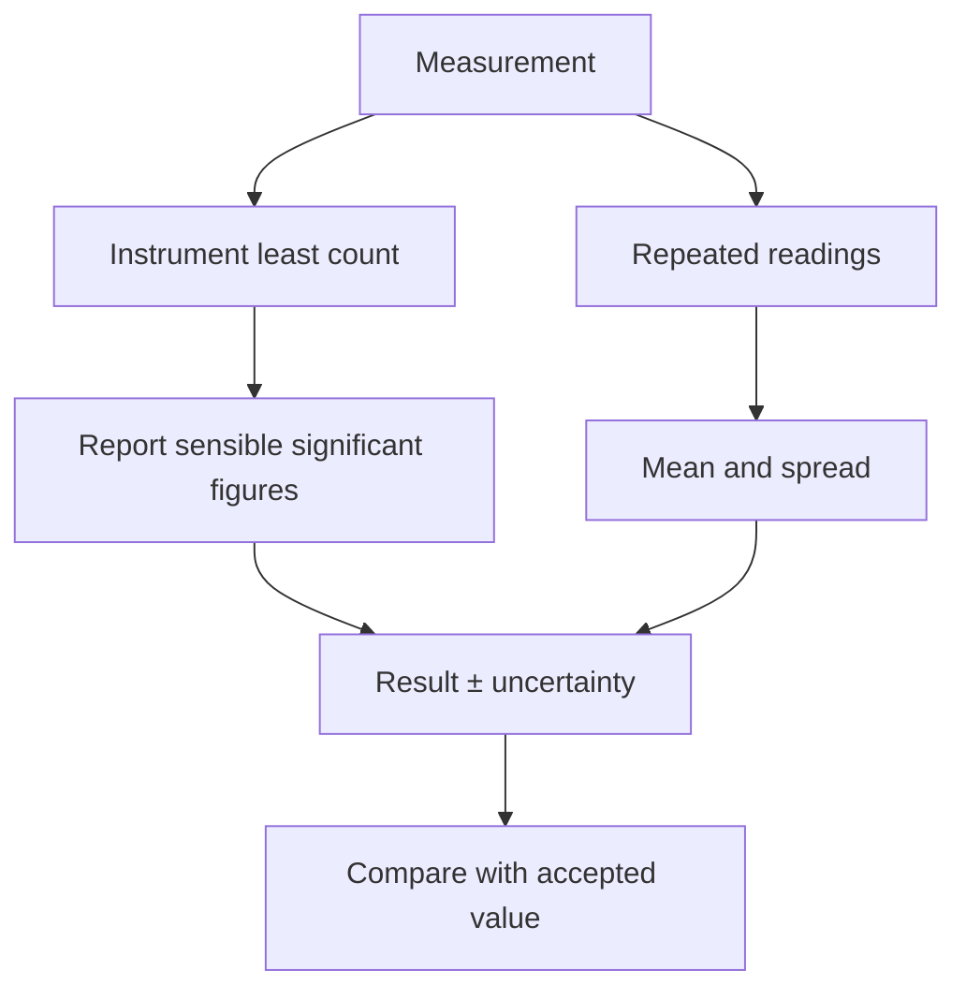
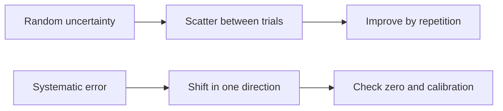

# Week 01 — Experimental Uncertainty and Data Analysis

**Course:** PHY 210/215 Physics I Laboratory  
**Manual:** Wilson & Hernández-Hall, *Physics Laboratory Experiments*, 8th ed., Experiment 2.  
**Study first:** Read the complete original experiment, equipment notes, figures and data-report tables. These supplemental notes do **not** replace local instructions.

## Objectives and ideas

- Least count
- Accuracy versus precision
- Random versus systematic error
- Significant figures
- Uncertainty
- Graphs.

## Visual diagrams

These original conceptual diagrams summarize the physics and measurement workflow; refer to the manual's apparatus figures for actual component positions.

### Concept / apparatus relationships

### Measurement and analysis map

## Pre-lab equipment and preparation

Confirm that all listed apparatus is present and working, locate scales/reference positions, inspect strings/fasteners, and write your measurement plan. Bring calculator, notebook, ruler, and graph paper as needed. Record apparatus-specific instrument resolution.

## Lab procedure — teaching summary

Inspect marked divisions and estimate one extra digit where appropriate. Complete the manual's least-count, significant-figure, error-analysis, and graphing exercises; show intermediate work.

## Equations, sample data, and worked calculation

### Main equations

- Mean: $\bar x=\frac{1}{n}\sum_i x_i$
- Estimated spread (half-range): $\Delta x\approx(x_{\max}-x_{\min})/2$
- Percent error: $\frac{|x_{\mathrm{exp}}-x_{\mathrm{accepted}}|}{|x_{\mathrm{accepted}}|}\times100\%$
- Percent difference (two measured values): $\frac{|A-B|}{(|A|+|B|)/2}\times100\%$

### Sample data table — illustrative values (not collected in class)

| Trial | Length (cm) |
| --- | --- |
| 1 | 10.1 |
| 2 | 10.2 |
| 3 | 10.0 |

### Sample calculation — Measurement uncertainty

$\bar x=(10.1+10.2+10.0)/3=10.1\ \mathrm{cm}$. Half-range estimate: $\Delta x=(10.2-10.0)/2=0.1\ \mathrm{cm}$. Report approximately **$(10.1\pm0.1)\ \mathrm{cm}$**, if half-range is the assigned uncertainty method. If the accepted length is 10.0 cm, percent error $=|10.1-10.0|/10.0\times100=1.0\%$. **Note:** the manual includes different uncertainty treatments; use the specified method for each question.

**Student reminder:** These values are examples for practice, **not** the manual's original measurements or a filled official report. Use your actual readings, the laboratory manual's specified tables, and the required units.

## Recording and analysis

Least count, reported measurements, uncertainty type, units, graph axes, trendline where requested.

Always preserve raw trial-by-trial readings before averaging. Use the manual's own report tables and attach graphs/calculations as requested. Discuss reasonable sources of systematic and random uncertainty.

## Safety and common mistakes

A long decimal is not necessarily accurate. Avoid rounding during intermediate steps.

## Preparation video

- [Find demonstrations for this week's topic on YouTube](https://www.youtube.com/results?search_query=measurement%20uncertainty%20accuracy%20precision%20physics%20lab) — **search-results link**, not a pre-screened specific video. Verify the apparatus and method before following a demonstration.
## Pre-lab thinking questions

1. Which physical quantity is controlled and which quantity is measured in this experiment?
2. What instrument reading is the largest source of uncertainty?
3. Which graph or equation allows you to test the theory?
4. What would a meaningful discrepancy between measured and predicted results tell you?

---

**Source note:** Written as original class guidance based on the manual's topic and available procedures; examples, simplified formulas and teaching advice may go beyond the exact lab handout. Consult the manual for the authoritative setup and report requirements.
