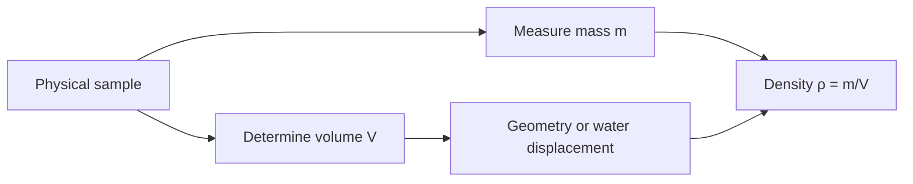
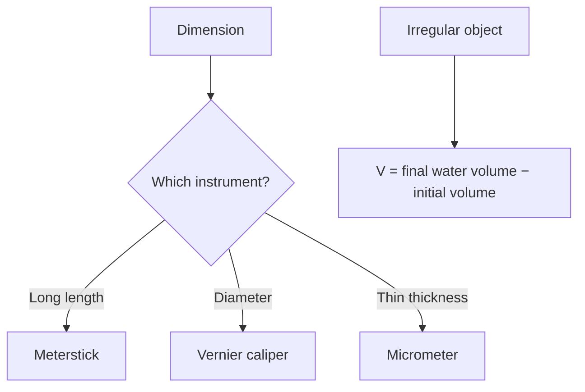

# Week 02 — Measurement and Determination of Density

**Course:** PHY 210/215 Physics I Laboratory  
**Manual:** Wilson & Hernández-Hall, *Physics Laboratory Experiments*, 8th ed., Experiment 3.  
**Study first:** Read the complete original experiment, equipment notes, figures and data-report tables. These supplemental notes do **not** replace local instructions.

## Objectives and ideas

- Meterstick
- Vernier caliper
- Micrometer
- Balance
- Graduated cylinder
- Regular and irregular solids.

## Visual diagrams

These original conceptual diagrams summarize the physics and measurement workflow; refer to the manual's apparatus figures for actual component positions.

### Concept / apparatus relationships

### Measurement and analysis map

## Pre-lab equipment and preparation

Confirm that all listed apparatus is present and working, locate scales/reference positions, inspect strings/fasteners, and write your measurement plan. Bring calculator, notebook, ruler, and graph paper as needed. Record apparatus-specific instrument resolution.

## Lab procedure — teaching summary

Identify each instrument's least count and zero correction. Measure one sheet versus stacked sheets; estimate manual pages. Measure rod, wire, sphere and sheet dimensions repeatedly; weigh samples and use water displacement for irregular solids.

## Main equations

- `${x}`
- `${x}`
- `${x}`
- `${x}`
- `${x}`

Use SI units unless the manual specifically requests another unit. Show the substitution of measured values and label final units.

## Recording and analysis

Table 1 least counts; Table 2 paper/manual measurements; Table 3 dimensions; Table 4 mass, volume, density, accepted value and errors.

Always preserve raw trial-by-trial readings before averaging. Use the manual's own report tables and attach graphs/calculations as requested. Discuss reasonable sources of systematic and random uncertainty.

## Safety and common mistakes

Read the vernier zero before its matching mark, check micrometer half-millimeter marks, remove bubbles when submerging objects.

## Preparation video

- [Find demonstrations for this week's topic on YouTube](https://www.youtube.com/results?search_query=vernier%20caliper%20micrometer%20density%20measurement%20physics%20laboratory) — **search-results link**, not a pre-screened specific video. Verify the apparatus and method before following a demonstration.
## Pre-lab thinking questions

1. Which physical quantity is controlled and which quantity is measured in this experiment?
2. What instrument reading is the largest source of uncertainty?
3. Which graph or equation allows you to test the theory?
4. What would a meaningful discrepancy between measured and predicted results tell you?

---

**Source note:** Written as original class guidance based on the manual's topic and available procedures; examples, simplified formulas and teaching advice may go beyond the exact lab handout. Consult the manual for the authoritative setup and report requirements.
