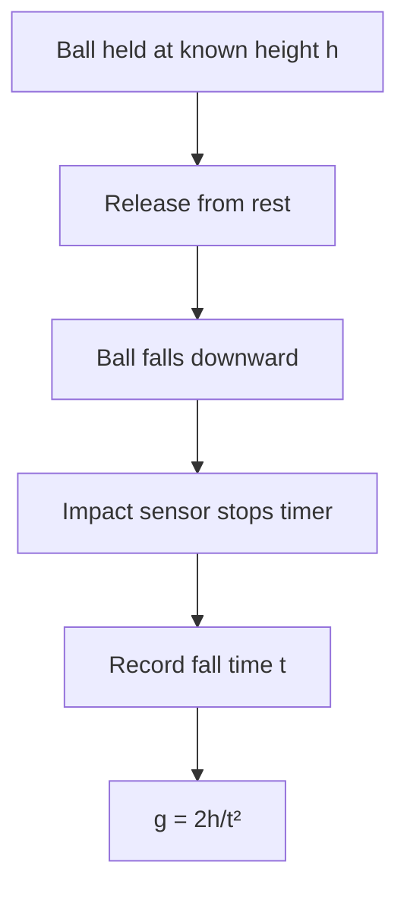

# Week 04 — Uniformly Accelerated Motion: Free Fall

**Course:** PHY 210/215 Physics I Laboratory  
**Manual:** Wilson & Hernández-Hall, *Physics Laboratory Experiments*, 8th ed., Experiment 5.  
**Study first:** Read the complete original experiment, equipment notes, figures and data-report tables. These supplemental notes do **not** replace local instructions.

## Objectives and ideas

- Motion under approximately constant gravity
- Timing a release from rest.

## Visual diagrams

These original conceptual diagrams summarize the physics and measurement workflow; refer to the manual's apparatus figures for actual component positions.

### Concept / apparatus relationships

### Measurement and analysis map

## Pre-lab equipment and preparation

Confirm that all listed apparatus is present and working, locate scales/reference positions, inspect strings/fasteners, and write your measurement plan. Bring calculator, notebook, ruler, and graph paper as needed. Record apparatus-specific instrument resolution.

## Lab procedure — teaching summary

Read the chosen manual variant and instructor's station instructions. Measure a series of drop heights, release without imparting speed, record repeated times using the installed timer or sensor, then determine acceleration from a suitable plot.

## Equations, sample data, and worked calculation

### Main equations

- Released from rest: $h=\tfrac12gt^2$
- $g=2h/t^2$
- Graph of $h$ versus $t^2$: slope $=g/2$
- General constant acceleration: $x=x_0+v_0t+\tfrac12at^2$

### Sample data table — illustrative values (not collected in class)

| Trial | Height h (m) | Fall time t (s) |
| --- | --- | --- |
| 1 | 0.800 | 0.403 |
| 2 | 0.800 | 0.404 |
| 3 | 0.800 | 0.405 |

### Sample calculation — Free-fall acceleration

Mean time $\bar t=(0.403+0.404+0.405)/3=0.404\ \mathrm{s}$. Assuming release from rest and negligible air drag, $g=2(0.800)/(0.404)^2=\mathbf{9.80\ m/s^2}$. The **course free-fall station** may have additional equipment-specific timing corrections; follow its sheet.

**Student reminder:** These values are examples for practice, **not** the manual's original measurements or a filled official report. Use your actual readings, the laboratory manual's specified tables, and the required units.

## Recording and analysis

Record height, repeated times, mean t, t² and inferred acceleration. Check whether the assigned manual variant expects a different position/time graph.

Always preserve raw trial-by-trial readings before averaging. Use the manual's own report tables and attach graphs/calculations as requested. Discuss reasonable sources of systematic and random uncertainty.

## Safety and common mistakes

Avoid standing under falling masses. The course calls this Free Fall but textbook Experiment 5 also includes different uniform-acceleration implementations; use local apparatus directions.

## Preparation video

- [Find demonstrations for this week's topic on YouTube](https://www.youtube.com/results?search_query=PASCO%20smart%20timer%20free%20fall%20experiment%20gravity%20ball%20release) — **search-results link**, not a pre-screened specific video. Verify the apparatus and method before following a demonstration.
### Manufacturer demonstration

- [PASCO Smart Timer video](https://www.pasco.com/resources/video/2OR6JzQDW18) — Smart Timer operation; check whether your station uses this instrument.

## Pre-lab thinking questions

1. Which physical quantity is controlled and which quantity is measured in this experiment?
2. What instrument reading is the largest source of uncertainty?
3. Which graph or equation allows you to test the theory?
4. What would a meaningful discrepancy between measured and predicted results tell you?

---

**Source note:** Written as original class guidance based on the manual's topic and available procedures; examples, simplified formulas and teaching advice may go beyond the exact lab handout. Consult the manual for the authoritative setup and report requirements.
