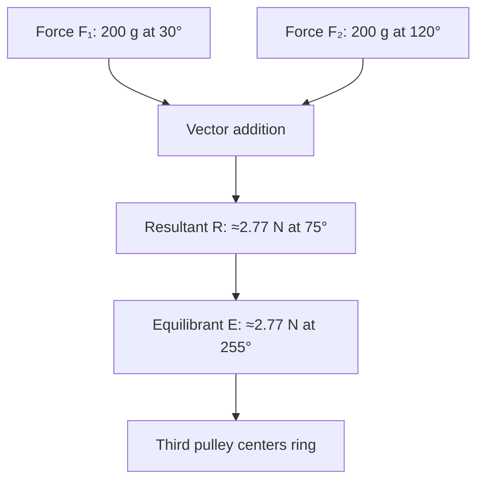
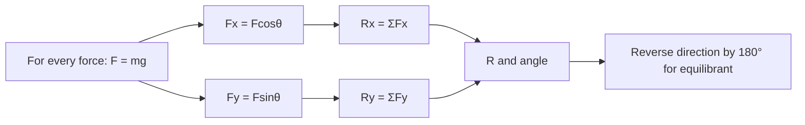

# Week 05 — Vector Addition: Force Table

**Course:** PHY 210/215 Physics I Laboratory  
**Manual:** Wilson & Hernández-Hall, *Physics Laboratory Experiments*, 8th ed., Experiment 6.  
**Study first:** Read the complete original experiment, equipment notes, figures and data-report tables. These supplemental notes do **not** replace local instructions.

## Objectives and ideas

- Forces as vectors
- Head-to-tail graphical addition
- Components
- Equilibrant.

## Visual diagrams

These original conceptual diagrams summarize the physics and measurement workflow; refer to the manual's apparatus figures for actual component positions.

### Concept / apparatus relationships

### Measurement and analysis map

## Pre-lab equipment and preparation

Confirm that all listed apparatus is present and working, locate scales/reference positions, inspect strings/fasteners, and write your measurement plan. Bring calculator, notebook, ruler, and graph paper as needed. Record apparatus-specific instrument resolution.

## Lab procedure — teaching summary

Level the force table and inspect hanger mass. Addition I: set total 0.200 kg at 30° and 0.200 kg at 120°; place a third pulley and adjust total equilibrant mass and direction to center ring. Repeat the book's specified cases and resolve a vector into components.

## Equations, sample data, and worked calculation

### Main equations

- Hanging tension: $F=mg$
- Components: $F_x=F\cos\theta$, $F_y=F\sin\theta$
- $R_x=\sum F_x$, $R_y=\sum F_y$
- $R=\sqrt{R_x^2+R_y^2}$; $\theta_R=\operatorname{atan2}(R_y,R_x)$
- Equilibrant: $\vec E=-\vec R$ (angle differs by 180°)

### Sample data table — illustrative values (not collected in class)

| Force | Total hanging mass | Angle | Magnitude |
| --- | --- | --- | --- |
| F₁ | 0.200 kg | 30° | 1.96 N |
| F₂ | 0.200 kg | 120° | 1.96 N |
| Equilibrant (theoretical) | 0.283 kg | 255° | 2.77 N |

### Sample calculation — Force-table vector addition I

$R_x=1.96\cos30^\circ+1.96\cos120^\circ=0.717\ \mathrm{N}$; $R_y=1.96\sin30^\circ+1.96\sin120^\circ=2.677\ \mathrm{N}$. Therefore $R=\sqrt{0.717^2+2.677^2}=\mathbf{2.77\ N}$ at **75°**. The balancing *equilibrant* is **2.77 N at 255°**, equivalent to **283 g total**, including the mass hanger.

**Student reminder:** These values are examples for practice, **not** the manual's original measurements or a filled official report. Use your actual readings, the laboratory manual's specified tables, and the required units.

## Additional illustrated practice tables

These filled tables are **hypothetical teaching examples**, organized around the manual's distinct measurement activities. They are **not actual measurements or copies of the manual's official report sheets**. Use the instructor's assigned apparatus and the printed tables for submissions.

### Manual addition cases I–III

| Case | First force | Second force | Analytical resultant |
| --- | --- | --- | --- |
| I | 1.96 N @30° | 1.96 N @120° | 2.77 N @75° |
| II | 1.96 N @20° | 1.47 N @80° | 2.99 N @45.3° |
| III | 1.96 N @0° | 1.47 N @90° | 2.45 N @36.9° |

### Resolution at 60°

| Applied force | Fx | Fy | Balancing direction |
| --- | --- | --- | --- |
| 2.94 N @60° | 1.47 N @0° | 2.55 N @90° | 240° |

### Compare three methods

| Method | Resultant magnitude | Resultant direction |
| --- | --- | --- |
| Graphical example | 2.75 N | 76° |
| Analytical | 2.77 N | 75° |
| Experimental example | 2.80 N | 74° |

### Three-force addition IV component workspace

| Force | Fx (N) | Fy (N) |
| --- | --- | --- |
| 0.98 N @30° | 0.849 | 0.490 |
| 1.96 N @90° | 0.000 | 1.960 |
| 2.94 N @225° | −2.079 | −2.079 |
| Sum | −1.230 | 0.371 |

## Recording and analysis

For each case compare graphical, analytical and experimental magnitude/angle. Addition I theoretical R ≈2.77 N at 75°, equilibrant ≈2.77 N at 255° (~283 g total).

Always preserve raw trial-by-trial readings before averaging. Use the manual's own report tables and attach graphs/calculations as requested. Discuss reasonable sources of systematic and random uncertainty.

## Safety and common mistakes

Mass settings include hanger. Experimental hanging force measures the equilibrant, not the resultant direction. Ring should be centered and free of pin friction.

## Preparation video

- [Find demonstrations for this week's topic on YouTube](https://www.youtube.com/results?search_query=physics%20force%20table%20vector%20addition%20equilibrant%20experiment%20pulleys) — **search-results link**, not a pre-screened specific video. Verify the apparatus and method before following a demonstration.
## Pre-lab thinking questions

1. Which physical quantity is controlled and which quantity is measured in this experiment?
2. What instrument reading is the largest source of uncertainty?
3. Which graph or equation allows you to test the theory?
4. What would a meaningful discrepancy between measured and predicted results tell you?

---

**Source note:** Written as original class guidance based on the manual's topic and available procedures; examples, simplified formulas and teaching advice may go beyond the exact lab handout. Consult the manual for the authoritative setup and report requirements.
