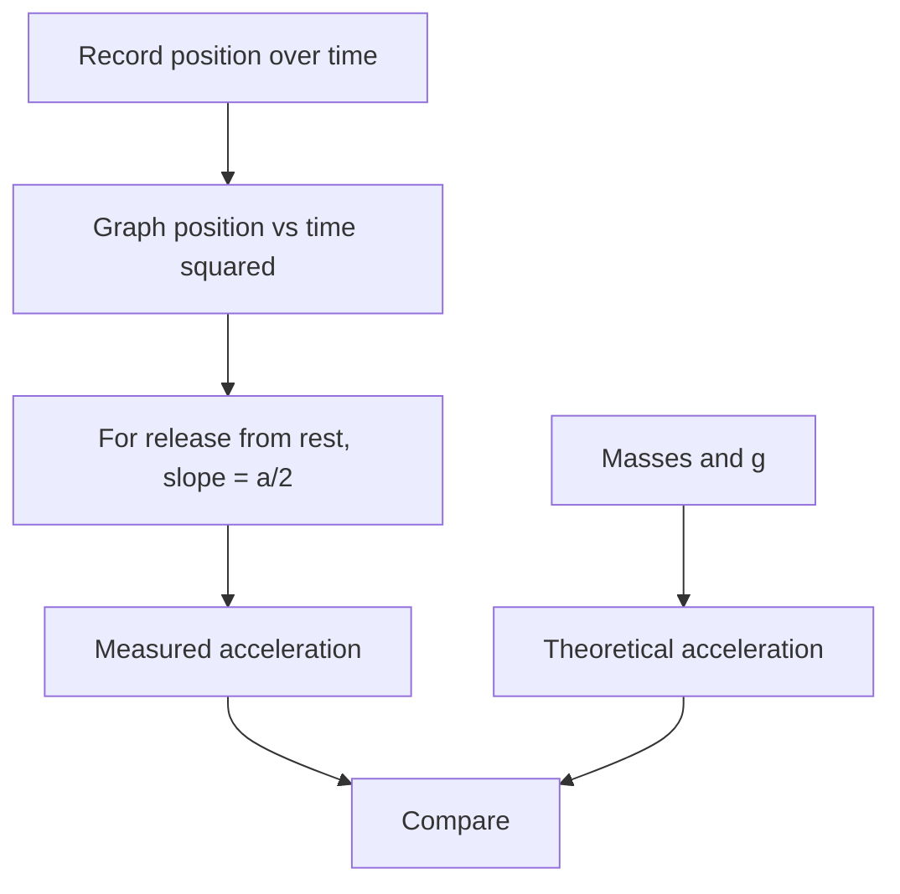

# Week 06 — Newton's Second Law: Atwood Machine

**Course:** PHY 210/215 Physics I Laboratory  
**Manual:** Wilson & Hernández-Hall, *Physics Laboratory Experiments*, 8th ed., Experiment 7.  
**Study first:** Read the complete original experiment, equipment notes, figures and data-report tables. These supplemental notes do **not** replace local instructions.

## Objectives and ideas

- Pulley, two unequal hanging masses and accelerated motion.

## Visual diagrams

These original conceptual diagrams summarize the physics and measurement workflow; refer to the manual's apparatus figures for actual component positions.

### Concept / apparatus relationships

### Measurement and analysis map

## Pre-lab equipment and preparation

Confirm that all listed apparatus is present and working, locate scales/reference positions, inspect strings/fasteners, and write your measurement plan. Bring calculator, notebook, ruler, and graph paper as needed. Record apparatus-specific instrument resolution.

## Lab procedure — teaching summary

Set up the book's Atwood machine variant, measure both total hanging masses and travel distances, release the system from rest and record time or motion sensor data. Repeat with prescribed mass changes and construct the manual's acceleration graph.

## Equations, sample data, and worked calculation

### Main equations

- Ideal system: $a=\frac{(m_2-m_1)g}{m_1+m_2}$ for $m_2>m_1$
- Displacement from rest: $s=\tfrac12at^2$
- Experimental $a=2s/t^2$
- From $s$ versus $t^2$ graph, $a=2(\text{slope})$

### Sample data table — illustrative values (not collected in class)

| Quantity | Sample value |
| --- | --- |
| m₁ (total) | 0.150 kg |
| m₂ (total) | 0.200 kg |
| Travel distance s | 0.700 m |
| Measured time t | 1.00 s |

### Sample calculation — Atwood acceleration

Ideal acceleration $a_{\rm ideal}=(0.200-0.150)(9.8)/(0.200+0.150)=\mathbf{1.40\ m/s^2}$. Experimental from the sample $a_{\rm exp}=2(0.700)/(1.00)^2=\mathbf{1.40\ m/s^2}$. Real systems can differ because of pulley inertia and friction. Use graph-derived acceleration if required by your manual's data table.

**Student reminder:** These values are examples for practice, **not** the manual's original measurements or a filled official report. Use your actual readings, the laboratory manual's specified tables, and the required units.

## Additional illustrated practice tables

These filled tables are **hypothetical teaching examples**, organized around the manual's distinct measurement activities. They are **not actual measurements or copies of the manual's official report sheets**. Use the instructor's assigned apparatus and the printed tables for submissions.

### Manual Table 1 — constant force

| m1 (kg) | m2 (kg) | Total (kg) | Net F (N) | Ideal a (m/s²) |
| --- | --- | --- | --- | --- |
| 0.150 | 0.200 | 0.350 | 0.490 | 1.40 |
| 0.200 | 0.250 | 0.450 | 0.490 | 1.09 |
| 0.250 | 0.300 | 0.550 | 0.490 | 0.891 |

### Manual Table 2 — constant system mass

| m1 (kg) | m2 (kg) | Total (kg) | Net F (N) | Ideal a (m/s²) |
| --- | --- | --- | --- | --- |
| 0.240 | 0.260 | 0.500 | 0.196 | 0.392 |
| 0.225 | 0.275 | 0.500 | 0.490 | 0.980 |
| 0.200 | 0.300 | 0.500 | 0.980 | 1.96 |

### Repeated timing

| Run | Distance (m) | Time (s) | Experimental a (m/s²) |
| --- | --- | --- | --- |
| 1 | 0.700 | 1.01 | 1.37 |
| 2 | 0.700 | 1.00 | 1.40 |
| 3 | 0.700 | 0.99 | 1.43 |

## Recording and analysis

Record masses (including holders), distances, raw times, calculated or graph-derived acceleration and comparison with theoretical value.

Always preserve raw trial-by-trial readings before averaging. Use the manual's own report tables and attach graphs/calculations as requested. Discuss reasonable sources of systematic and random uncertainty.

## Safety and common mistakes

Secure pulley and stop descending mass before it hits the ground; consider pulley friction/inertia as experimental effects.

## Preparation video

- [Find demonstrations for this week's topic on YouTube](https://www.youtube.com/results?search_query=Atwood%20machine%20acceleration%20two%20masses%20single%20pulley%20physics%20lab) — **search-results link**, not a pre-screened specific video. Verify the apparatus and method before following a demonstration.
## Pre-lab thinking questions

1. Which physical quantity is controlled and which quantity is measured in this experiment?
2. What instrument reading is the largest source of uncertainty?
3. Which graph or equation allows you to test the theory?
4. What would a meaningful discrepancy between measured and predicted results tell you?

---

**Source note:** Written as original class guidance based on the manual's topic and available procedures; examples, simplified formulas and teaching advice may go beyond the exact lab handout. Consult the manual for the authoritative setup and report requirements.
