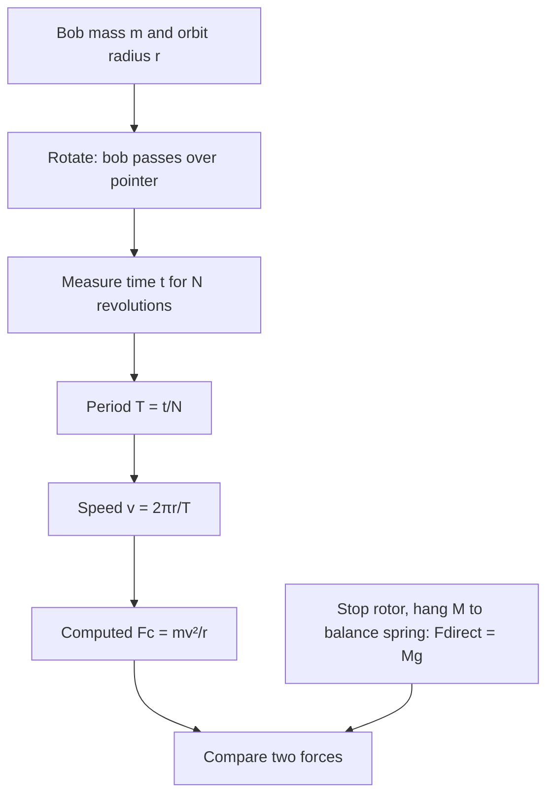

# Week 07 — Centripetal Force

**Course:** PHY 210/215 Physics I Laboratory  
**Manual:** Wilson & Hernández-Hall, *Physics Laboratory Experiments*, 8th ed., Experiment 10.  
**Study first:** Read the complete original experiment, equipment notes, figures and data-report tables. These supplemental notes do **not** replace local instructions.

## Objectives and ideas

- Circular motion of spring-attached bob
- Period and spring tension.

## Visual diagrams

These original conceptual diagrams summarize the physics and measurement workflow; refer to the manual's apparatus figures for actual component positions.

### Concept / apparatus relationships

### Measurement and analysis map

## Pre-lab equipment and preparation

Confirm that all listed apparatus is present and working, locate scales/reference positions, inspect strings/fasteners, and write your measurement plan. Bring calculator, notebook, ruler, and graph paper as needed. Record apparatus-specific instrument resolution.

## Lab procedure — teaching summary

Weigh bob; adjust pointer radius from rotor axis; align hanging bob over pointer before attaching spring. Rotate shaft so moving bob passes over pointer, time ~25 revolutions at least 10 seconds, repeat 3 trials. Stop rotation, attach string over pulley opposite spring and add total hanging weights until bob is back at pointer.

## Main equations

- `${x}`
- `${x}`
- `${x}`
- `${x}`

Use SI units unless the manual specifically requests another unit. Show the substitution of measured values and label final units.

## Recording and analysis

Manual Tables 1–4: baseline, vary bob mass (+100 g or more), vary radius, optionally vary spring stiffness. For each: three times, period, speed, Fc, Mg and percent difference.

Always preserve raw trial-by-trial readings before averaging. Use the manual's own report tables and attach graphs/calculations as requested. Discuss reasonable sources of systematic and random uncertainty.

## Safety and common mistakes

Never leave hanging calibration weights attached during rotation. Wear eye protection, tighten locking screws and keep clear of counterweight.

## Preparation video

- [Find demonstrations for this week's topic on YouTube](https://www.youtube.com/results?search_query=Sargent%20Welch%20hand%20operated%20centripetal%20force%20spring%20bob%20experiment) — **search-results link**, not a pre-screened specific video. Verify the apparatus and method before following a demonstration.
### Additional filmed demonstration

- [Saint Mary's University: Centripetal Force](https://www.demos.smu.ca/demos/mechanics/144-centripetal-force) — related apparatus demonstration.

## Pre-lab thinking questions

1. Which physical quantity is controlled and which quantity is measured in this experiment?
2. What instrument reading is the largest source of uncertainty?
3. Which graph or equation allows you to test the theory?
4. What would a meaningful discrepancy between measured and predicted results tell you?

---

**Source note:** Written as original class guidance based on the manual's topic and available procedures; examples, simplified formulas and teaching advice may go beyond the exact lab handout. Consult the manual for the authoritative setup and report requirements.
