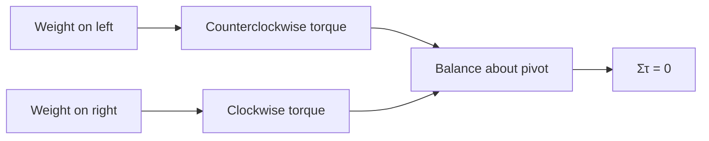
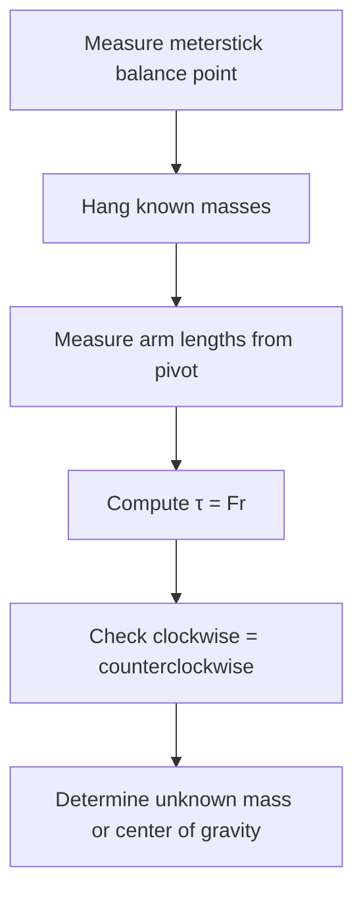

# Week 08 — Torques and Equilibrium

**Course:** PHY 210/215 Physics I Laboratory  
**Manual:** Wilson & Hernández-Hall, *Physics Laboratory Experiments*, 8th ed., Experiment 14.  
**Study first:** Read the complete original experiment, equipment notes, figures and data-report tables. These supplemental notes do **not** replace local instructions.

## Objectives and ideas

- Lever arm
- Torque
- Balance
- Center of gravity.

## Visual diagrams

These original conceptual diagrams summarize the physics and measurement workflow; refer to the manual's apparatus figures for actual component positions.

### Concept / apparatus relationships

### Measurement and analysis map

## Pre-lab equipment and preparation

Confirm that all listed apparatus is present and working, locate scales/reference positions, inspect strings/fasteners, and write your measurement plan. Bring calculator, notebook, ruler, and graph paper as needed. Record apparatus-specific instrument resolution.

## Lab procedure — teaching summary

Locate the meterstick's balance point. Support at its center of gravity for early cases, suspend masses on either side and adjust moment arms for equilibrium. Determine an unknown mass from torques. Then shift pivot, account for meterstick's own mass and experimentally find system center of gravity.

## Equations, sample data, and worked calculation

### Main equations

- $\tau=rF\sin\phi$
- $\sum F=0$, $\sum\tau=0$
- Perpendicular weights: $m_1gr_1=m_2gr_2$
- Center of gravity: $x_{cm}=\sum m_ix_i/\sum m_i$

### Sample data table — illustrative values (not collected in class)

| Side | Mass (kg) | Arm (m) | Torque (N·m) |
| --- | --- | --- | --- |
| Left | 0.100 | 0.200 | 0.196 CCW |
| Right | 0.200 | 0.100 | 0.196 CW |

### Sample calculation

$\tau_L=(0.100)(9.8)(0.200)=0.196\ \mathrm{N\,m}$; $\tau_R=(0.200)(9.8)(0.100)=0.196\ \mathrm{N\,m}$. Equal opposite torques produce $\sum\tau=0$. Include clamp mass, and include meterstick weight when pivot is off its balance point.

**Student reminder:** These are illustrative data, not the manual's original table entries or measurements. Complete the official lab report using actual readings and the manual's required conventions.

## Additional illustrated practice tables

These are **hypothetical example datasets**, not actual class measurements or reproductions of the manual's report pages. Match the installed apparatus and submit data in the manual's official tables.

### Torque balance cases

| Case | Left mass (kg) | Left arm (m) | Right mass (kg) | Right arm (m) |
| --- | --- | --- | --- | --- |
| A | 0.100 | 0.200 | 0.200 | 0.100 |
| B | 0.150 | 0.160 | 0.200 | 0.120 |

### Unknown-mass lever

| Known counterweight | Known arm | Unknown arm | Unknown mass |
| --- | --- | --- | --- |
| 0.200 kg | 0.120 m | 0.160 m | 0.150 kg |

### Shifted pivot and stick weight

| Force source | Mass (kg) | Arm (m) | Torque (N m) |
| --- | --- | --- | --- |
| Left mass | 0.100 | 0.200 | 0.196 CCW |
| Stick | 0.100 | 0.050 | 0.049 CW |
| Right mass | 0.150 | 0.100 | 0.147 CW |

## Recording and analysis

Manual Table 1 cases of balanced loads and unknown mass; Table 2 noncentral pivot and center-of-gravity cases. Record positions, moment arms, clamp masses, clockwise/counterclockwise torques.

Always preserve raw trial-by-trial readings before averaging. Use the manual's own report tables and attach graphs/calculations as requested. Discuss reasonable sources of systematic and random uncertainty.

## Safety and common mistakes

Include clamp/hook masses if used; torques must reference a specified pivot. Do not assume the stick's balance point is exactly 50 cm.

## Preparation video

- [Find demonstrations for this week's topic on YouTube](https://www.youtube.com/results?search_query=meterstick%20torque%20equilibrium%20center%20of%20gravity%20physics%20lab) — **search-results link**, not a pre-screened specific video. Verify the apparatus and method before following a demonstration.
## Pre-lab thinking questions

1. Which physical quantity is controlled and which quantity is measured in this experiment?
2. What instrument reading is the largest source of uncertainty?
3. Which graph or equation allows you to test the theory?
4. What would a meaningful discrepancy between measured and predicted results tell you?

---

**Source note:** Written as original class guidance based on the manual's topic and available procedures; examples, simplified formulas and teaching advice may go beyond the exact lab handout. Consult the manual for the authoritative setup and report requirements.
