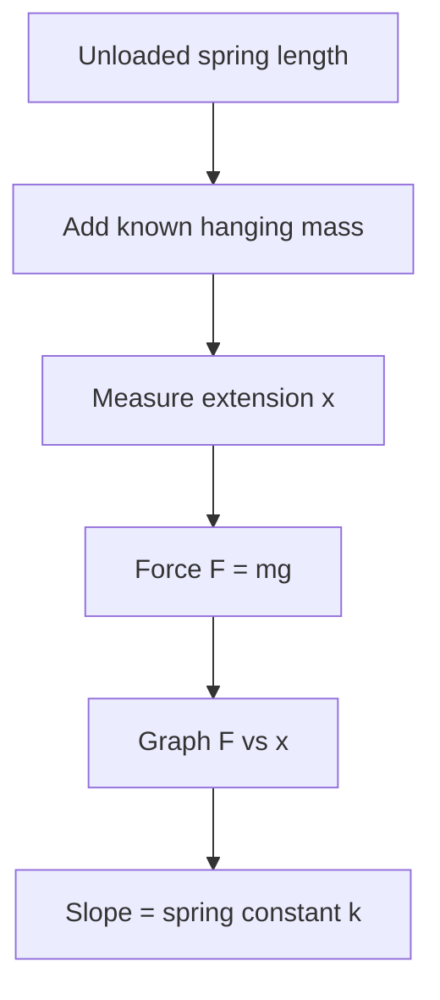
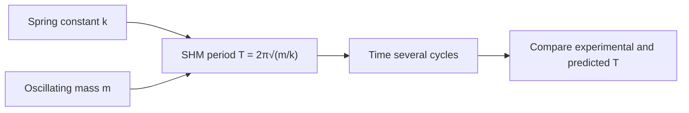

# Week 10 — Hooke's Law and Simple Harmonic Motion

**Course:** PHY 210/215 Physics I Laboratory  
**Manual:** Wilson & Hernández-Hall, *Physics Laboratory Experiments*, 8th ed., Experiment 13 (plus Experiment 16 if SHM assigned).  
**Study first:** Read the complete original experiment, equipment notes, figures and data-report tables. These supplemental notes do **not** replace local instructions.

## Objectives and ideas

- Force versus extension and spring energy
- Use Exp 16 for oscillations if assigned.

## Visual diagrams

These original conceptual diagrams summarize the physics and measurement workflow; refer to the manual's apparatus figures for actual component positions.

### Concept / apparatus relationships

### Measurement and analysis map

## Pre-lab equipment and preparation

Confirm that all listed apparatus is present and working, locate scales/reference positions, inspect strings/fasteners, and write your measurement plan. Bring calculator, notebook, ruler, and graph paper as needed. Record apparatus-specific instrument resolution.

## Lab procedure — teaching summary

Hang a spring vertically and measure unstretched reference. Add successive known masses, read extensions, and graph applied force versus extension to find stiffness k. If SHM is included, time many oscillations for a hanging mass and compare the period prediction. The local schedule combines topics drawn from more than one manual experiment.

## Equations, sample data, and worked calculation

### Main equations

- Hooke's law: $F=-kx$
- Magnitude of force at equilibrium: $mg=kx$
- Spring potential energy: $U_s=\tfrac12kx^2$
- Ideal mass-spring period: $T=2\pi\sqrt{m/k}$

### Sample data table — illustrative values (not collected in class)

| Hanging mass (kg) | Force (N) | Extension (m) |
| --- | --- | --- |
| 0.050 | 0.490 | 0.020 |
| 0.100 | 0.980 | 0.040 |
| 0.150 | 1.470 | 0.060 |

### Sample calculation

Slope of force-versus-extension graph: $k=0.980/0.040=\mathbf{24.5\ N/m}$. With oscillating mass 0.100 kg, predicted $T=2\pi\sqrt{0.100/24.5}=\mathbf{0.401\ s}$. At $x=0.040$ m, $U_s=\tfrac12(24.5)(0.040)^2=\mathbf{0.0196\ J}$. The course combines Hooke's law and SHM: check whether manual Experiment 13, 16 or both are assigned.

**Student reminder:** These are illustrative data, not the manual's original table entries or measurements. Complete the official lab report using actual readings and the manual's required conventions.

## Recording and analysis

Record added total mass, force, extension, graph slope k; for SHM also number of oscillations and period. If doing the manual's spring-energy test, record its release/turning-point heights.

Always preserve raw trial-by-trial readings before averaging. Use the manual's own report tables and attach graphs/calculations as requested. Discuss reasonable sources of systematic and random uncertainty.

## Safety and common mistakes

Never overstretch spring; record position reference carefully and do not mix centimeters with meters.

## Preparation video

- [Find demonstrations for this week's topic on YouTube](https://www.youtube.com/results?search_query=Hookes%20law%20spring%20constant%20simple%20harmonic%20motion%20spring%20mass%20laboratory) — **search-results link**, not a pre-screened specific video. Verify the apparatus and method before following a demonstration.
## Pre-lab thinking questions

1. Which physical quantity is controlled and which quantity is measured in this experiment?
2. What instrument reading is the largest source of uncertainty?
3. Which graph or equation allows you to test the theory?
4. What would a meaningful discrepancy between measured and predicted results tell you?

---

**Source note:** Written as original class guidance based on the manual's topic and available procedures; examples, simplified formulas and teaching advice may go beyond the exact lab handout. Consult the manual for the authoritative setup and report requirements.
