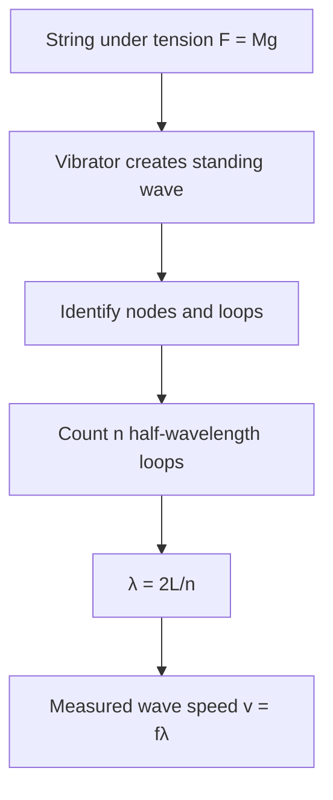
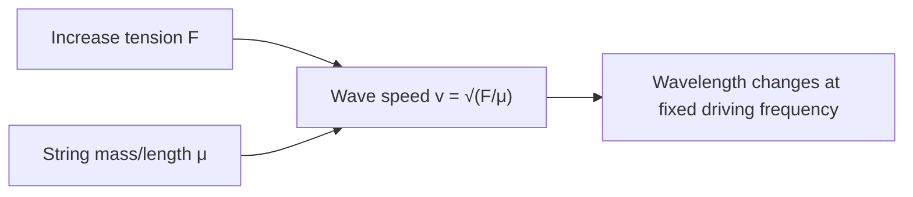

# Week 11 — Standing Waves in a String

**Course:** PHY 210/215 Physics I Laboratory  
**Manual:** Wilson & Hernández-Hall, *Physics Laboratory Experiments*, 8th ed., Experiment 17.  
**Study first:** Read the complete original experiment, equipment notes, figures and data-report tables. These supplemental notes do **not** replace local instructions.

## Objectives and ideas

- Nodes, antinodes, harmonic patterns, wavelength and tension.

## Visual diagrams

These original conceptual diagrams summarize the physics and measurement workflow; refer to the manual's apparatus figures for actual component positions.

### Concept / apparatus relationships

### Measurement and analysis map

## Pre-lab equipment and preparation

Confirm that all listed apparatus is present and working, locate scales/reference positions, inspect strings/fasteners, and write your measurement plan. Bring calculator, notebook, ruler, and graph paper as needed. Record apparatus-specific instrument resolution.

## Lab procedure — teaching summary

Run the string vibrator with string routed over pulley to hanging masses. Adjust tension and vibrating span to obtain stable two-, three- and further-loop patterns as directed; measure lengths between indicated nodal positions. Determine wavelengths and wave speed.

## Main equations

- `${x}`
- `${x}`
- `${x}`
- `${x}`

Use SI units unless the manual specifically requests another unit. Show the substitution of measured values and label final units.

## Essential equations and worked example

### Main equations

- Tension: $F\approx Mg$
- Linear density: $\mu=m_{string}/L_{string}$
- Wave speed: $v=\sqrt{F/\mu}=f\lambda$
- For n half-wavelength loops: $\lambda=2L/n$

### Sample data table — illustrative values (not collected in class)

| Measurement | Example |
| --- | --- |
| Total hanger mass M | 0.200 kg |
| String density μ | 0.00200 kg/m |
| Frequency f | 50.0 Hz |
| Loops n | 2 |
| Effective L | 0.625 m |

### Sample calculation

$F=(0.200)(9.8)=1.96\ \mathrm N$. Theoretical wave speed $v=\sqrt{1.96/0.002}=\mathbf{31.3\ m/s}$. For $n=2$, $\lambda=2(0.625)/2=0.625\ \mathrm m$; hence measured $v=f\lambda=50.0(0.625)=\mathbf{31.25\ m/s}$. Follow the manual's node-position measurement convention.

**Student reminder:** These are illustrative data, not the manual's original table entries or measurements. Complete the official lab report using actual readings and the manual's required conventions.

## Recording and analysis

Record string's linear density, frequency, total hanging mass, loop counts, measured node distances, λ and predicted/measured velocities. Match the manual's measurement convention.

Always preserve raw trial-by-trial readings before averaging. Use the manual's own report tables and attach graphs/calculations as requested. Discuss reasonable sources of systematic and random uncertainty.

## Safety and common mistakes

Avoid touching energized vibrating parts; do not pull string so hard that suspended hanger rises.

## Preparation video

- [Find demonstrations for this week's topic on YouTube](https://www.youtube.com/results?search_query=standing%20waves%20on%20a%20string%20Melde%20experiment%20string%20vibrator%20harmonics) — **search-results link**, not a pre-screened specific video. Verify the apparatus and method before following a demonstration.
## Pre-lab thinking questions

1. Which physical quantity is controlled and which quantity is measured in this experiment?
2. What instrument reading is the largest source of uncertainty?
3. Which graph or equation allows you to test the theory?
4. What would a meaningful discrepancy between measured and predicted results tell you?

---

**Source note:** Written as original class guidance based on the manual's topic and available procedures; examples, simplified formulas and teaching advice may go beyond the exact lab handout. Consult the manual for the authoritative setup and report requirements.
