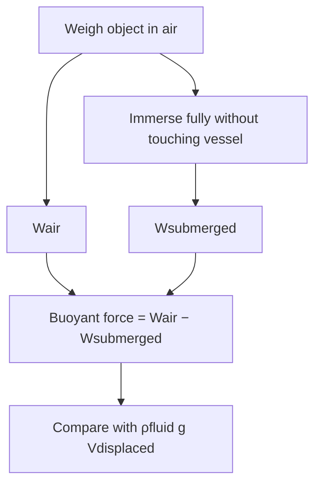
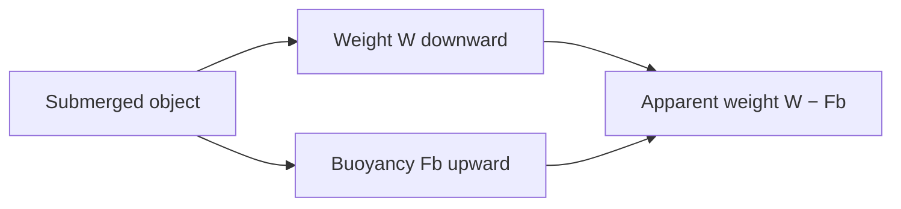

# Week 12 — Archimedes' Principle

**Course:** PHY 210/215 Physics I Laboratory  
**Manual:** Wilson & Hernández-Hall, *Physics Laboratory Experiments*, 8th ed., Experiment 21.  
**Study first:** Read the complete original experiment, equipment notes, figures and data-report tables. These supplemental notes do **not** replace local instructions.

## Objectives and ideas

- Buoyancy, displaced water, and submerged apparent weight.

## Visual diagrams

These original conceptual diagrams summarize the physics and measurement workflow; refer to the manual's apparatus figures for actual component positions.

### Concept / apparatus relationships

### Measurement and analysis map

## Pre-lab equipment and preparation

Confirm that all listed apparatus is present and working, locate scales/reference positions, inspect strings/fasteners, and write your measurement plan. Bring calculator, notebook, ruler, and graph paper as needed. Record apparatus-specific instrument resolution.

## Lab procedure — teaching summary

Measure object weight in air and apparent weight when fully immersed without touching vessel. Determine buoyant force from weight difference; compare to weight of displaced fluid. Use geometry or displaced-water volume to infer density where assigned.

## Main equations

- `${x}`
- `${x}`
- `${x}`

Use SI units unless the manual specifically requests another unit. Show the substitution of measured values and label final units.

## Essential equations and worked example

### Main equations

- Buoyancy: $F_b=\rho_{fluid}gV_{displaced}$
- $F_b=W_{air}-W_{submerged}$
- $\rho_{object}=m/V$
- Fully immersed: $V=F_b/(\rho_{fluid}g)$

### Sample data table — illustrative values (not collected in class)

| Quantity | Example |
| --- | --- |
| Weight in air | 2.45 N |
| Weight submerged | 1.96 N |
| Water density | 1000 kg/m³ |

### Sample calculation

$F_b=2.45-1.96=\mathbf{0.49\ N}$. Volume $V=0.49/(1000\times9.8)=5.00\times10^{-5}\ \mathrm{m^3}$. Mass $m=2.45/9.8=0.250\ \mathrm{kg}$, so density $\rho=0.250/(5.00\times10^{-5})=\mathbf{5000\ kg/m^3}$. Do not let immersed object touch vessel walls or floor.

**Student reminder:** These are illustrative data, not the manual's original table entries or measurements. Complete the official lab report using actual readings and the manual's required conventions.

## Recording and analysis

Record air weight, submerged weight, displaced volume/fluid density, calculated buoyant force and density; distinguish floating, fully submerged and partially submerged cases.

Always preserve raw trial-by-trial readings before averaging. Use the manual's own report tables and attach graphs/calculations as requested. Discuss reasonable sources of systematic and random uncertainty.

## Safety and common mistakes

Dislodge air bubbles, do not let object touch vessel bottom or sides, read meniscus at eye level.

## Preparation video

- [Find demonstrations for this week's topic on YouTube](https://www.youtube.com/results?search_query=Archimedes%20principle%20buoyant%20force%20displacement%20apparent%20weight%20physics%20lab) — **search-results link**, not a pre-screened specific video. Verify the apparatus and method before following a demonstration.
## Pre-lab thinking questions

1. Which physical quantity is controlled and which quantity is measured in this experiment?
2. What instrument reading is the largest source of uncertainty?
3. Which graph or equation allows you to test the theory?
4. What would a meaningful discrepancy between measured and predicted results tell you?

---

**Source note:** Written as original class guidance based on the manual's topic and available procedures; examples, simplified formulas and teaching advice may go beyond the exact lab handout. Consult the manual for the authoritative setup and report requirements.
