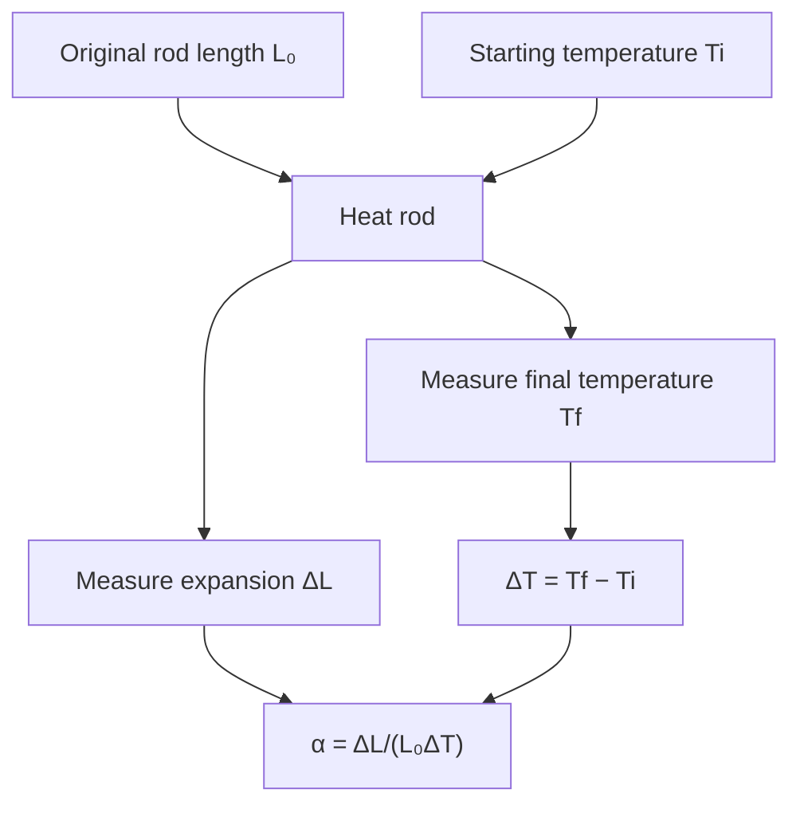
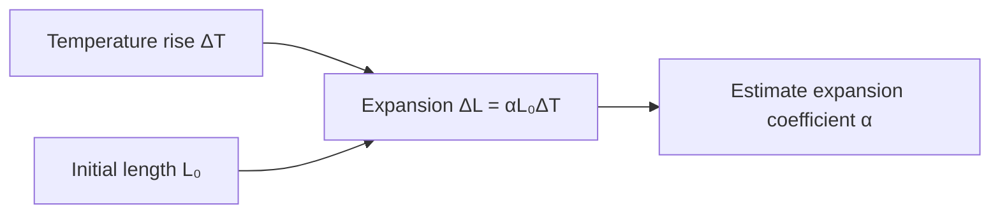

# Week 13 — Thermal Coefficient of Expansion

**Course:** PHY 210/215 Physics I Laboratory  
**Manual:** Wilson & Hernández-Hall, *Physics Laboratory Experiments*, 8th ed., Experiment 19.  
**Study first:** Read the complete original experiment, equipment notes, figures and data-report tables. These supplemental notes do **not** replace local instructions.

## Objectives and ideas

- Change in solid length as temperature rises.

## Visual diagrams

These original conceptual diagrams summarize the physics and measurement workflow; refer to the manual's apparatus figures for actual component positions.

### Concept / apparatus relationships

### Measurement and analysis map

## Pre-lab equipment and preparation

Confirm that all listed apparatus is present and working, locate scales/reference positions, inspect strings/fasteners, and write your measurement plan. Bring calculator, notebook, ruler, and graph paper as needed. Record apparatus-specific instrument resolution.

## Lab procedure — teaching summary

Measure original rod length and initial temperature. Install rod in expansion device, allow heated steam/hot water to bring it near final temperature, and record its length change and final temperature after equilibration.

## Equations, sample data, and worked calculation

### Main equations

- $\Delta T=T_f-T_i$
- $\Delta L=\alpha L_0\Delta T$
- $\alpha=\Delta L/(L_0\Delta T)$

### Sample data table — illustrative values (not collected in class)

| Quantity | Example |
| --- | --- |
| Initial rod length | 0.500 m |
| Initial temperature | 20 °C |
| Final temperature | 100 °C |
| Length increase | 0.000920 m |

### Sample calculation

$\Delta T=100-20=80\ ^\circ\mathrm C$. Expansion coefficient $\alpha=0.000920/(0.500\times80)=\mathbf{2.30\times10^{-5}\ ^\circ C^{-1}}$. Note $0.000920\ \mathrm m=0.920\ \mathrm{mm}$. Handle heated rods and steam lines as burn hazards.

**Student reminder:** These are illustrative data, not the manual's original table entries or measurements. Complete the official lab report using actual readings and the manual's required conventions.

## Recording and analysis

Record sample material, initial length, initial/final temperatures, measured expansion, calculated α and accepted value.

Always preserve raw trial-by-trial readings before averaging. Use the manual's own report tables and attach graphs/calculations as requested. Discuss reasonable sources of systematic and random uncertainty.

## Safety and common mistakes

Steam and hot metal cause burns; protect hands/eyes, do not touch heated rod and keep tubing secure.

## Preparation video

- [Find demonstrations for this week's topic on YouTube](https://www.youtube.com/results?search_query=linear%20thermal%20expansion%20metal%20rod%20steam%20expansion%20apparatus%20laboratory) — **search-results link**, not a pre-screened specific video. Verify the apparatus and method before following a demonstration.
## Pre-lab thinking questions

1. Which physical quantity is controlled and which quantity is measured in this experiment?
2. What instrument reading is the largest source of uncertainty?
3. Which graph or equation allows you to test the theory?
4. What would a meaningful discrepancy between measured and predicted results tell you?

---

**Source note:** Written as original class guidance based on the manual's topic and available procedures; examples, simplified formulas and teaching advice may go beyond the exact lab handout. Consult the manual for the authoritative setup and report requirements.
