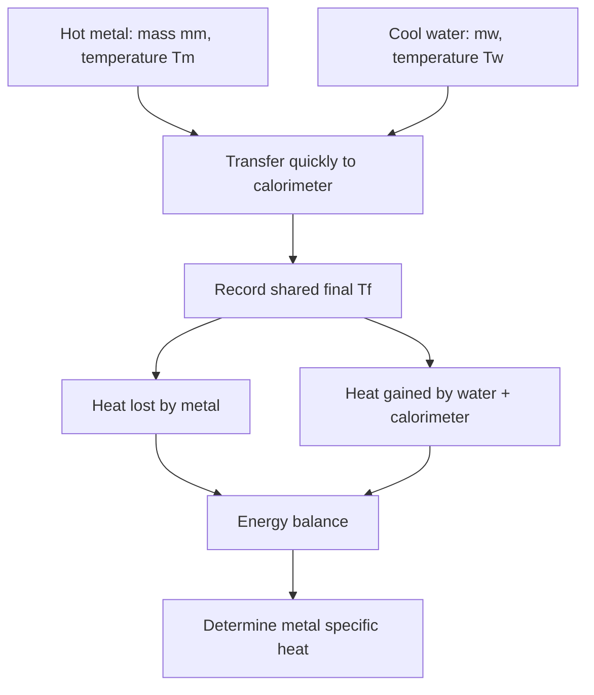
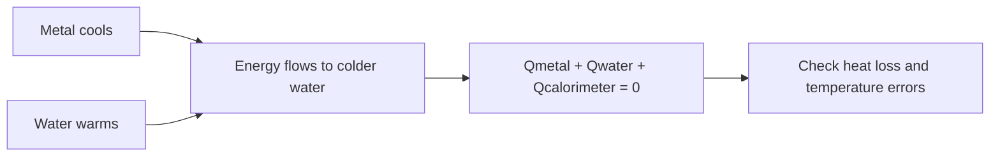

# Week 14 — Specific Heat of a Metal

**Course:** PHY 210/215 Physics I Laboratory  
**Manual:** Wilson & Hernández-Hall, *Physics Laboratory Experiments*, 8th ed., Experiment 20.  
**Study first:** Read the complete original experiment, equipment notes, figures and data-report tables. These supplemental notes do **not** replace local instructions.

## Objectives and ideas

- Heat transfer and calorimetry.

## Visual diagrams

These original conceptual diagrams summarize the physics and measurement workflow; refer to the manual's apparatus figures for actual component positions.

### Concept / apparatus relationships

### Measurement and analysis map

## Pre-lab equipment and preparation

Confirm that all listed apparatus is present and working, locate scales/reference positions, inspect strings/fasteners, and write your measurement plan. Bring calculator, notebook, ruler, and graph paper as needed. Record apparatus-specific instrument resolution.

## Lab procedure — teaching summary

Measure masses and initial temperatures of water/calorimeter and heated metal. Heat the metal in a controlled bath; transfer dry heated sample promptly to the insulated calorimeter; record equilibrium temperature, repeat as assigned.

## Equations, sample data, and worked calculation

### Main equations

- Thermal balance: $Q_{metal}+Q_{water}+Q_{calorimeter}=0$
- Heating: $Q=mc\Delta T$
- If calorimeter heat is negligible: $c_m=\frac{m_wc_w(T_f-T_w)}{m_m(T_m-T_f)}$

### Sample data table — illustrative values (not collected in class)

| Quantity | Example |
| --- | --- |
| Hot metal mass | 0.100 kg |
| Metal initial temp | 90 °C |
| Water mass | 0.200 kg |
| Water initial temp | 20 °C |
| Equilibrium temp | 24 °C |

### Sample calculation

Water absorbs $Q_w=(0.200)(4186)(24-20)=3348.8\ \mathrm J$. Neglecting calorimeter heat, $c_m=3348.8/[0.100(90-24)]=\mathbf{507\ J/(kg\cdot{}^\circ C)}$. If the manual supplies calorimeter heat capacity, add its heat gain. Transfer and dry the hot metal carefully.

**Student reminder:** These are illustrative data, not the manual's original table entries or measurements. Complete the official lab report using actual readings and the manual's required conventions.

## Recording and analysis

Record masses and temperature readings, computed specific heat and accepted value, percent error. Include calorimeter heat capacity if required by instructor/manual.

Always preserve raw trial-by-trial readings before averaging. Use the manual's own report tables and attach graphs/calculations as requested. Discuss reasonable sources of systematic and random uncertainty.

## Safety and common mistakes

Use tongs and goggles. Hot metal/water burn; avoid splashing and dry metal before transfer.

## Preparation video

- [Find demonstrations for this week's topic on YouTube](https://www.youtube.com/results?search_query=specific%20heat%20capacity%20metal%20calorimetry%20hot%20metal%20water%20physics%20laboratory) — **search-results link**, not a pre-screened specific video. Verify the apparatus and method before following a demonstration.
## Pre-lab thinking questions

1. Which physical quantity is controlled and which quantity is measured in this experiment?
2. What instrument reading is the largest source of uncertainty?
3. Which graph or equation allows you to test the theory?
4. What would a meaningful discrepancy between measured and predicted results tell you?

---

**Source note:** Written as original class guidance based on the manual's topic and available procedures; examples, simplified formulas and teaching advice may go beyond the exact lab handout. Consult the manual for the authoritative setup and report requirements.
